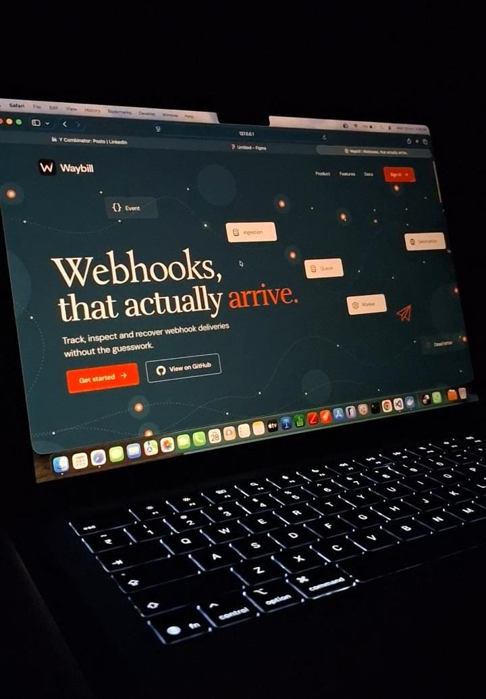
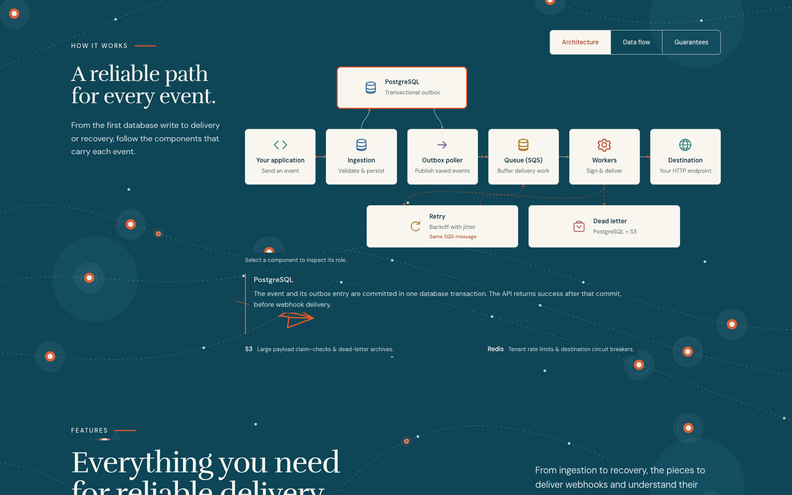
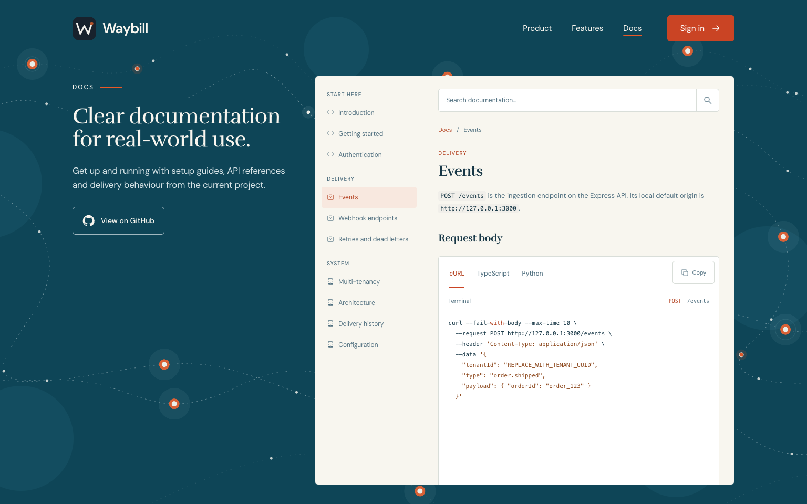
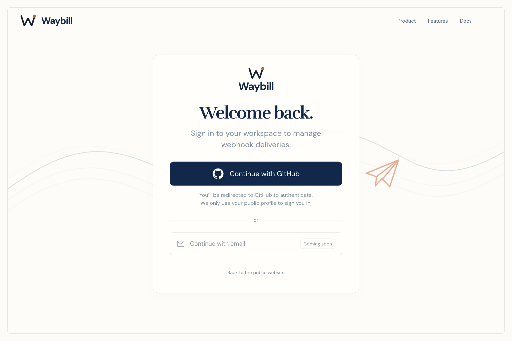
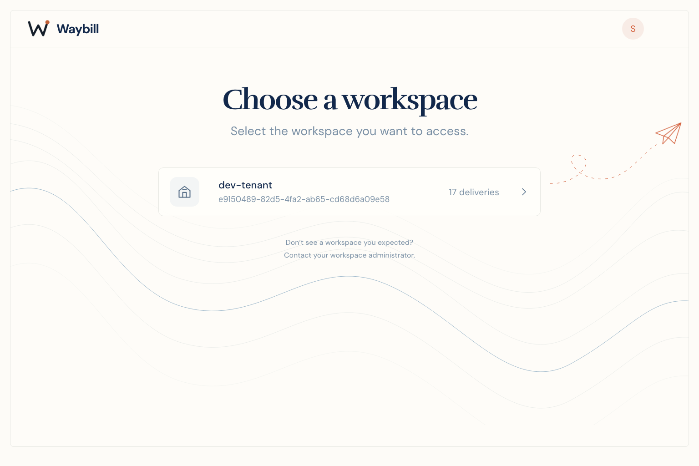
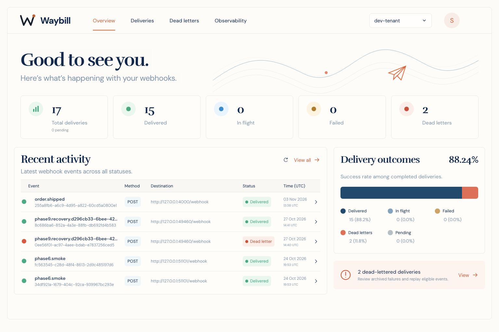
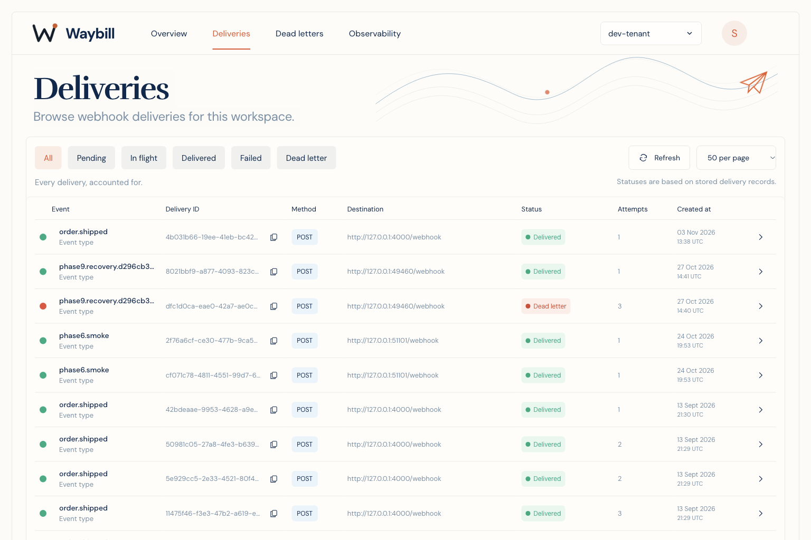
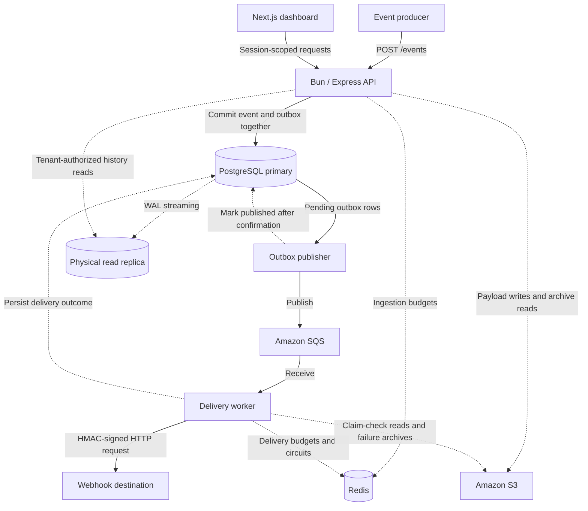
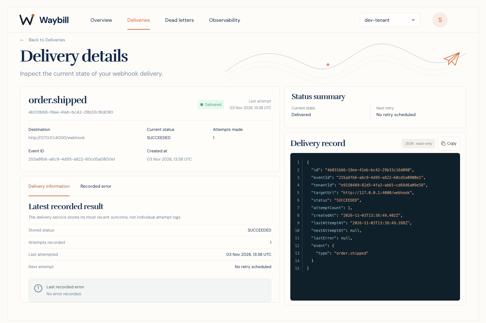
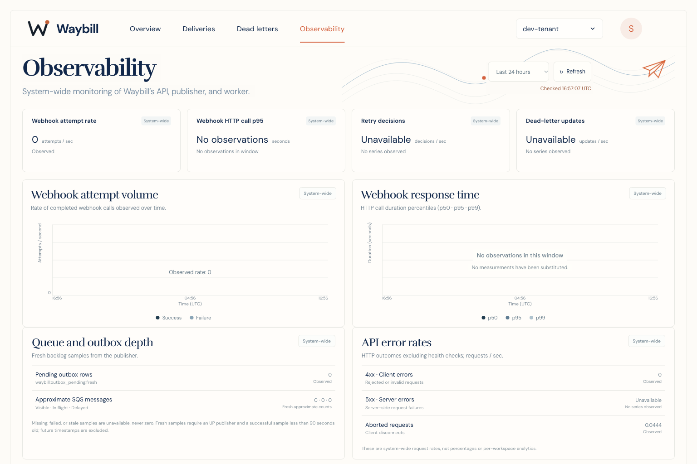

<div align="center">
  
  <h1>Waybill</h1>
  <p><strong>Webhooks, that actually arrive.</strong></p>
  <p>Waybill is a multi-tenant webhook delivery platform. It persists accepted events, delivers signed HTTP requests through a durable queue, and keeps the delivery record available for inspection and recovery.</p>
  <p>A waybill travels with a shipment and records its journey. This one follows HTTP events.</p>
</div>

<div align="center">
  
</div>

## Accepted is not delivered

A successful ingestion response means the event was persisted. The destination may still be slow, unavailable, or returning errors. Waybill separates acceptance, queue publication, delivery, and recovery so a failure between those stages leaves work to resume and a record to investigate.

- **Durable acceptance:** an event and its outbox row commit in one PostgreSQL transaction.
- **Controlled delivery:** tenant budgets, fair-queue scheduling, circuit breakers, and bounded retries govern attempts.
- **Inspection and recovery:** delivery records, archived failures, and idempotent manual replay share an authenticated dashboard.
- **Operational visibility:** real service metrics distinguish backlog, failures, idle windows, and missing observations.

Processing is **at least once**. A receiver can process a request before its success is recorded, so it must deduplicate by event ID. An unavailable destination eventually produces an archived failure; acceptance is not a promise that every destination will acknowledge delivery.

## The public website and documentation

The public site introduces the delivery model through an interactive architecture view. The separate documentation page covers the existing API, authentication, retries, tenant isolation, and integration examples. Both belong to the same Next.js application as the dashboard.

<table>
  <tr>
    <td width="50%"><a href="assets/readme/architecture.png"></a></td>
    <td width="50%"><a href="assets/readme/documentation.png"></a></td>
  </tr>
</table>

## Identity and workspace access

GitHub OAuth establishes identity; tenant membership grants workspace access. Signing in does not create a tenant. The workspace selector lists authorized memberships and scopes subsequent queries to the selected tenant.

Opaque sessions use HttpOnly cookies. Session-backed writes require Origin and CSRF checks; tenant authorization is checked on the primary before reading data. API keys have the fixed `events:write` scope, reveal their secret once, and support expiry and revocation.

<table>
  <tr>
    <td width="50%"><a href="assets/readme/sign-in.png"></a></td>
    <td width="50%"><a href="assets/readme/workspace-selection.png"></a></td>
  </tr>
</table>

## Delivery management

Overview summarizes recorded outcomes and recent activity. Deliveries exposes the underlying records with supported status filters, refresh, and cursor-based pagination. Selecting a row opens its own detail route while preserving workspace context.

The workspace below contains persisted deliveries from local runs. A failed record is described as awaiting retry only when it has a stored schedule. Delivery details shows metadata, the latest stored error, and read-only record JSON. Individual attempt histories and response logs are not stored.

<table>
  <tr>
    <td width="50%"><a href="assets/readme/overview.png"></a></td>
    <td width="50%"><a href="assets/readme/deliveries.png"></a></td>
  </tr>
</table>

## What happens after ingestion

The API commits an event and its outbox row together before returning `201 Created`. The publisher reads pending outbox rows while holding a PostgreSQL advisory lock and rotates selections across tenants. It marks a row published only after SQS confirms the send.

The worker receives that message, checks delivery controls, and sends a signed request to the configured destination. A crash between sending and recording confirmation can repeat publication or delivery, preserving at-least-once semantics.



Workers sign the exact serialized request bytes with HMAC-SHA256 and send `X-Waybill-Signature: sha256=<digest>`. Payloads above the configured 256 KiB inline threshold use S3 claim-checks, leaving an object reference in the queue. The included receiver verifies the raw body, signature, and tenant.

Redis holds independent ingestion and dispatch token buckets, circuit-breaker state, and related cache state. SQS remains the queue. MessageGroupId identifies tenants for fair scheduling; publisher rotation, bounded receive cycles, tenant turns, and visibility renewal also limit how much work a busy tenant occupies.

Dashboard history reads use a separate connection that verifies a physical standby inside a read-only transaction. Sessions, membership, API keys, and authoritative replay decisions remain on the primary. Replica lag can delay a display update without deciding whether a user is authorized.

## Retries, dead letters, and replay

HTTP failures use exponential backoff with full jitter, a one-second base, a sixty-second cap, and a default budget of eight attempts. A retry persists its next attempt time and delays the same SQS message. Circuit-breaker, rate-limit, not-yet-due, and tenant-turn deferrals are kept distinct from an HTTP attempt.

The JSON inspector shows the stored delivery record. Dead letters retrieves the archived request payload separately, keeping delivery metadata distinct from the data needed for replay.

<div align="center">
  <a href="assets/readme/delivery-details.png"></a>
</div>

Exhausted deliveries retain their payload and failure state. An eligible replay checks the primary, archive, and configured destination, then commits a new event, outbox row, and audit record together. Tenant-scoped idempotency keys and uniqueness constraints prevent duplicate replay commands for the same source. The original failure remains available.

Archival or persistence failures do not count as completed delivery. Delivery and replay share the destination configured by `RECEIVER_URL`. See the [detailed retry and replay flows](docs/waybill-architecture.md) for recovery sequences and guarantees.

## Operational visibility

API, publisher, and worker expose private Prometheus listeners. Grafana covers request and webhook durations, retries, terminal outcomes, queue depth, outbox backlog, and process resources.

The application uses fixed server-side queries for its Observability page. Every request checks the operator's verified numeric GitHub ID, including requests served from cached measurements.

Metrics are **system-wide**. Zero, idle windows, missing series, stale samples, and non-finite values remain distinct; the screenshot below shows an idle window without substituting measurements. PostgreSQL retains delivery history, while Prometheus describes running services. Grafana has its own authentication, and raw monitoring endpoints stay private.

<div align="center">
  <a href="assets/readme/observability.png"></a>
</div>

## Engineering decisions and evidence

The boundaries are deliberate:

- Separate API, publisher, and worker processes let persistence, queue publication, and delivery fail independently.
- The outbox preserves accepted publication work. Queue acknowledgement follows recorded completion, while receivers still need idempotency.
- A physical replica provides a separate read path, with eventual consistency in the dashboard and primary-backed security decisions.
- No delivery-table bottleneck was demonstrated, so deliveries remain unsharded. API and worker shutdown still rely on crash/visibility recovery rather than an explicit drain.

The local workload evidence is narrower than a production performance claim:

| Local check | Verified result |
| --- | --- |
| Baseline across three tenants | 300 accepted events and 300 durable successes; request-to-receiver p95 of 6.667 seconds |
| Unchanged accepted-pressure comparison | Overlapping bounded confirmations reduced worst quiet-tenant p95 from 69.864 to 8.468 seconds |
| Preparation regression run | 67 frontend/security tests and 114 backend tests passed; six opt-in database tests skipped |

Busy-tenant tails remained substantial. These runs used a laptop, local PostgreSQL/Redis/receiver, and real development AWS resources. They do not establish production capacity, automatic failover, or a latency guarantee. [Workloads, thresholds, and limitations](docs/PHASE_9_NOTES.md).

## Technology

| Layer | Implementation |
| --- | --- |
| Public site and dashboard | Next.js App Router, React, TypeScript, Tailwind CSS v4, Motion |
| Backend processes | Bun 1.4.3, Express, TypeScript |
| Storage | PostgreSQL 16, Prisma, physical read replica |
| Delivery and archives | Transactional outbox, Amazon SQS standard queue, Amazon S3 |
| Admission and delivery controls | Redis token buckets and circuit breakers |
| Access and telemetry | GitHub OAuth, server-side sessions, scoped API keys, Prometheus, Grafana |

## Local development

Use Bun 1.4.3 and Docker Compose. Copy `.env.example` to the ignored `.env` and configure its database, Redis, development AWS, and receiver settings. Real dashboard access also needs GitHub OAuth, `API_AUTH_MODE=session`, and tenant membership; follow the [authentication setup](docs/AUTHENTICATION.md).

```bash
cp .env.example .env
bun install --frozen-lockfile
bun run prisma:generate
docker compose up -d postgres redis
bunx prisma@5.22.0 migrate deploy --schema packages/shared/prisma/schema.prisma
bun run setup:replica
bun run seed:tenant
```

Then run `bun run dev:api`, `bun run dev:poller`, `bun run dev:worker`, `bun run dev:receiver`, and `bun run dev:web` in separate terminals. Open [127.0.0.1:3001](http://127.0.0.1:3001). Full delivery flows use real SQS/S3 resources; configure the receiver with the seeded tenant's matching signing secret before sending events.

For checks, run `bun run check:backend`, `bun test packages/web/tests`, `bun run check:web`, and `bun run test:backend`. The default backend suite skips database-dependent tests; CI runs those against a fresh primary and replica.

[Web and build commands](packages/web/README.md), [replica setup](docs/PHASE_7_NOTES.md), [monitoring setup](docs/PHASE_8_NOTES.md), and [load/recovery test prerequisites](docs/PHASE_9_NOTES.md) cover the remaining setup and verification details.

## Deployment status

**Prepared, not deployed.** The [Oracle runbook](docs/ORACLE_DEPLOYMENT.md) and [configuration](infra/oracle/) target one Always Free ARM64 VM for Next.js, the backend processes, primary/replica, Redis, and private monitoring. SQS and S3 stay on AWS. The public website can launch first; persistent backend activation requires verified account coverage and fail-closed credit/expiry checks. There is no public deployment URL yet.

## Further reading

- **Architecture and reliability:** [system architecture](docs/waybill-architecture.md), [replica and replay](docs/PHASE_7_NOTES.md).
- **Access and integration:** [authentication and tenant access](docs/AUTHENTICATION.md), [web application](packages/web/README.md).
- **Operations and evidence:** [monitoring](docs/PHASE_8_NOTES.md), [load and recovery tests](docs/PHASE_9_NOTES.md), [Oracle deployment](docs/ORACLE_DEPLOYMENT.md).
- **Design notes:** [project guide](docs/project-guide.md), [backend and system-design notes](docs/FINAL_NOTES.md).

## License

Copyright 2026 Shreya Mishra. Licensed under the [Apache License 2.0](LICENSE).
