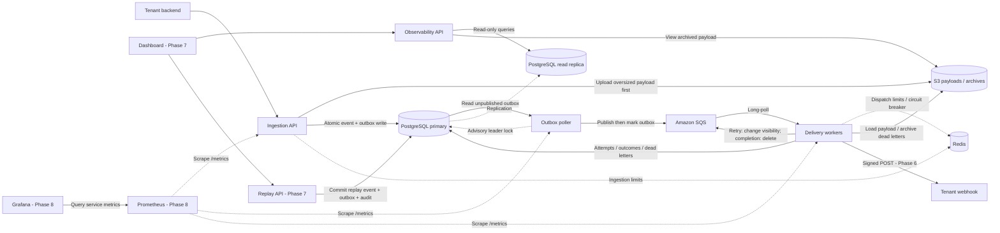

# Waybill - Project Guide

A multi-tenant webhook delivery platform, built to learn distributed systems. A waybill is the document that travels with a shipment and proves it arrived. This project applies that idea to HTTP events.

---

## 1. Problem Statement

Company A's backend needs to notify Company B's server when events happen ("payment.succeeded", "order.shipped"). Company B's endpoint may be slow, down, or flaky. The system must guarantee **every event eventually arrives**, **without losing events**, **without hammering dead endpoints**, and **without one noisy tenant starving others** - across thousands of tenants concurrently.

---

## 2. Tech Stack

| Layer | Choice | Why |
|---|---|---|
| Language/Runtime | TypeScript on Bun | Runs TS directly (no build step, even in Docker), fast installs/cold starts |
| API Framework | Express | Simple, well-documented, easy to reason about layer by layer |
| Database | PostgreSQL | Source of truth - tenants, events, deliveries, outbox |
| ORM | Prisma | Type-safe, migrations built in |
| Queue | **Amazon SQS** | Real managed queue - long polling, visibility timeouts, at-least-once delivery. Free tier covers this project many times over |
| Large payload / archive storage | **Amazon S3** | Claim-check pattern: SQS caps messages at 256KB, so payloads over that go to S3 and the queue carries a pointer. Also doubles as a permanent audit archive of delivered/failed payloads |
| Cache / rate limit / circuit breaker state | **Redis** | Per-tenant token buckets, per-destination circuit breaker state, hot tenant config. Not the queue anymore - SQS is |
| Containerization | Docker + docker-compose | Postgres + Redis run locally in containers; SQS/S3 are real AWS, hit directly even from your laptop |
| Logging | **Pino** | Structured JSON logs, correlation IDs threaded through API → queue → worker |
| Service metrics - Phase 8 | **Prometheus + Grafana** | Collect process and delivery metrics, then use dashboards to investigate load-test bottlenecks |
| Deployment | Railway or Render → AWS later if desired | Get something live early |

Local development needs an AWS account for SQS and S3. Start with the core delivery flow. Kafka and other infrastructure experiments can wait until the later phases.

### What this project does and doesn't teach

The main topics are:

- Message queues, caching, rate limiting, eventual consistency through the outbox, tenant-facing delivery history, and service metrics before load testing.
- Leader election with Postgres advisory locks in Phase 2, a read replica in Phase 7, and sharding in Phase 9 if load tests show a need for it.
- Service discovery and distributed transactions/SAGAs are out of scope. Waybill does not have a service mesh or coordinate business transactions across services.

---

## 3. High-Level Architecture

The [architecture document](./waybill-architecture.md) defines the Phase 0-9 target, component boundaries, repository layout, and implementation status. It includes HMAC signing, observability, replay, and read-replica routing. The PDF is an earlier Phases 0-5 snapshot.



HMAC signing, the local read replica, delivery read APIs, and outbox-based manual replay are implemented. API, publisher, and worker metric collection are implemented. Background backlog sampling is also implemented. Local Prometheus/Grafana setup and provisioned service dashboards are implemented. The tenant dashboard and hosted replica remain pending. Automatic retries use `ChangeMessageVisibility` on the existing SQS message. Manual replay is a separate Phase 7 operation. On retry exhaustion, the worker archives the payload and persists the dead-letter state before calling `DeleteMessage`. Delivery attempts are at least once; receivers must handle duplicates.

The tenant dashboard reads durable delivery records through the replica. Prometheus and Grafana will show service behavior across the API, publisher, and workers. Metrics do not replace tenant delivery history or replay auditing.

**Tenant fairness:** the publisher sets `MessageGroupId = tenantId` on every outgoing message. This enables [SQS fair queue scheduling](https://docs.aws.amazon.com/AWSSimpleQueueService/latest/SQSDeveloperGuide/sqs-fair-queues.html) on the existing standard queue. Workers retain per-tenant Redis token buckets, bounded receive buffering, and an explicit ten-message per-tenant turn budget. Excess selections are deferred in visibility batches. Buffered reservations are renewed and released before deliberate retry delays or deletion. Queue scheduling reduces noisy-tenant interference; Redis enforces the delivery budget. FIFO ordering remains an optional Phase 10 change. The accepted-backlog test validates the combined behavior.

---

## 4. Repo structure

```
waybill/
├── docker-compose.yml
├── docker-compose.replica.yml
├── infra/
│   ├── postgres/
│   └── monitoring/                     Prometheus rules and Grafana provisioning
├── .env.example
├── packages/
│   ├── api/
│   │   └── src/
│   │       ├── routes/
│   │       ├── controllers/
│   │       ├── services/
│   │       ├── repositories/
│   │       └── middleware/
│   ├── worker/
│   │   └── src/
│   │       ├── jobs/
│   │       └── delivery/
│   ├── shared/
│   │   └── prisma/schema.prisma
│   └── dashboard/
└── docs/
```

---

## 5. Working habits

Work one phase at a time. Propose a file plan before writing code. Keep the layered structure (routes → controllers → services → repositories). Handle every async/AWS call explicitly. Explain *why* a pattern is used in comments, not just what the code does. Runtime is Bun (no build step). TypeScript strict mode.

- After each phase, write your own `PHASE_N_NOTES.md` - what was built and why. This becomes your own system design writeup later.
- Commit after every checkpoint, not after every file.

---

## 6. Phases & Checkpoints

Implementation order: complete the Phase 7 observability and replay backend, add service metrics in Phase 8, then use those measurements for Phase 9 load testing and backend hardening. Build and connect the authenticated tenant dashboard after the backend checkpoints. Hosted replication stays with deployment. FIFO, multiple regions, and Kafka remain separate optional Phase 10 experiments; they do not block dashboard integration.

While finishing Phase 7, keep HTTP handling and delivery operations easy to instrument. Metric collection belongs at operation boundaries. Tenant IDs, event IDs, URLs, and error text stay in logs and database records rather than metric labels.

### Phase 0 - Scaffolding - complete

- [x] Monorepo, Docker Compose (Postgres + Redis), Prisma schema + first migration
- [x] Empty API returns 200 on `GET /health`
- [x] AWS credentials in `.env`; `bun run check:aws` reaches the project SQS queue and S3 bucket
- [x] Notes: `docs/PHASE_0_NOTES.md`

### Phase 1 - Ingestion API + Outbox - complete

- [x] Layered `POST /events` writes Event + Outbox in one DB transaction
- [x] Small payload stored inline (`storedIn: "postgres"`)
- [x] Payload > 256KB stored via S3 claim-check (`payload` null, `payloadS3Key` set)
- [x] Notes: `docs/PHASE_1_NOTES.md`

### Phase 2 - Outbox Poller + Basic Delivery Worker - complete

- [x] Test receiver on `:4000`
- [x] Outbox poller publishes unpublished rows to SQS
- [x] Worker long-polls SQS and POSTs to the receiver
- [x] Two pollers: `pg_try_advisory_lock` so each row publishes once
- [x] Notes: `docs/PHASE_2_NOTES.md`

A poller reads unpublished outbox rows, sends them to SQS (`SendMessage`), marks them published. The worker long-polls SQS, POSTs to a test receiver, marks delivery succeeded or failed, and deletes the SQS message only on success. No retries yet.

Leader election: `pg_try_advisory_lock` on a single Postgres connection. Only the lock holder polls. The standby takes over if the leader disconnects.

Done when: a POSTed event becomes a real HTTP call on the receiver, the SQS message is deleted only after success, and two pollers produce one publish per row.

### Phase 3 - Retries with Backoff + Dead Letter - complete

- [x] `dead_letters` table (payload archived at `payload_s3_key`)
- [x] Exponential backoff + jitter before retrying a failed delivery
- [x] After N attempts, delete from SQS and write a dead-letter row
- [x] Notes: `docs/PHASE_3_NOTES.md`

On failure, do not delete the SQS message. Let visibility expire so it is redelivered. Track attempts on `deliveries` and wait with exponential backoff plus jitter. After `MAX_DELIVERY_ATTEMPTS`, delete from SQS, archive the payload to S3 if needed, and insert `dead_letters`.

Done when: attempt timestamps grow exponentially, and exhausted events land in `dead_letters` with the payload retrievable from S3.

### Phase 4 - Circuit Breaker
- [x] Redis-backed circuit breaker keyed by destination URL: closed → open (after N consecutive failures) → half-open (test one request) → closed/open again. Checked by the worker *before* every delivery attempt, independent of SQS.
- [x] Killing the test receiver causes the worker to stop attempting delivery for a cooldown window instead of retrying constantly, then automatically probes again.
- [x] Notes: `docs/PHASE_4_NOTES.md`

### Phase 5 - Rate Limiting & Multi-Tenant Fairness
- [x] Token bucket per tenant in Redis, applied at ingestion (`POST /events`) and at dispatch (worker skips over-limit tenants' messages instead of blocking).
- [x] Independent ingestion and delivery budgets per tenant.
- [x] Repeatable 10k-request runner with baseline and per-tenant delivery measurements.
- [x] Verify the rate-limited 10k-request burst with concurrent quiet-tenant traffic.
- [x] Add an accepted-backlog runner with controlled worker start and preload evidence.
- [x] Meet the local quiet-tenant p95 criterion under a 1,000-event accepted backlog.
- Accepted-backlog result on 2026-10-22: explicit tenant turns and batched visibility deferrals reduced quiet p95 from 106.9 to 25.2 seconds. All 1,000 busy events and 444 quiet load events arrived. Quiet maximum was 63.5 seconds and busy maximum was 513.6 seconds; tail latency and throughput tradeoffs still need hardening.
- Measured quiet-tenant p95 improved from 226 seconds to 25.7 seconds against the unchanged 30-second threshold. All accepted events arrived. The passing run admitted 246 of the busy tenant's 10,000 requests; the rest received HTTP 429.
- Notes: [Phase 5](./PHASE_5_NOTES.md), including test settings and measured limitations.
- **Done when:** simulate one tenant firing 10k events while another tenant's events still get delivered promptly, even though both share the same SQS queue.

### Phase 6 - Security: HMAC Signing & Verification
- [x] Sign each webhook payload with a per-tenant secret (HMAC-SHA256) and send a signature header.
- [x] Provide an example receiver that verifies raw request bytes and rejects tampered payloads.
- Notes: [Phase 6](./PHASE_6_NOTES.md). Local HTTP verification and a live AWS smoke test passed, including inline and S3-backed events. Tampered requests returned HTTP 401.
- **Done when:** a tampered payload fails verification on the receiver side.

### Phase 7 - Observability and Replay APIs

The tenant dashboard is deferred to the final integration checkpoints below. The existing public website is separate from the authenticated tenant dashboard.

- [x] Add a separate replica client with read-only transactions and standby validation.
- [x] Add a local Docker replica and verify routing with a controlled replication-lag test.
- [ ] Configure a managed read replica during deployment; this does not block local backend phases.
- [x] Add tenant-filtered delivery history with status filtering, cursor pagination, and live replica HTTP tests.
- [x] Add replica-backed status counts and a terminal-outcome success rate per tenant.
- [x] Add paginated dead-letter browsing and bounded archived-payload retrieval from S3.
- [x] Add idempotent manual replay through the transactional outbox, preserving original failures.
- Notes: [Phase 7](./PHASE_7_NOTES.md). Local replication, observability APIs, archived payload reads, and live replay are verified; the dashboard and hosted replication remain pending.
- Delivery logs per tenant, success rate, DLQ browsing (pulling archived payloads from S3), manual replay (re-send to SQS).
- **Replication:** develop against the local Docker physical replica; use a managed Postgres read replica for deployment and dashboard queries. Ingestion and worker status updates stay on the primary. This keeps dashboard read traffic off the write database.
- **Backend done locally when:** history, summary, dead-letter inspection, and durable idempotent replay are verified, including tenant filtering and controlled replica lag. This is complete. Dashboard integration and managed replication remain explicitly separate work.

### Phase 8 - Service Metrics with Prometheus & Grafana

Prometheus and Grafana move forward from the stretch goals so Phase 9 has measurements to work with. Start this phase after the Phase 7 backend is verified. It does not depend on the tenant dashboard.

- [x] Define metric names, units, histogram buckets, and bounded labels before adding instrumentation. See [Phase 8 notes](./PHASE_8_NOTES.md). Labels may describe a fixed service, operation, outcome, status class, or deferral reason; exclude tenant IDs, event IDs, destination URLs, and free-form errors.
- [x] Add opt-in API request metrics and a separate loopback-only scrape listener; verify bounded labels, parser errors, disconnects, and independent collection.
- [x] Add scrape endpoints for the API, outbox publisher, and delivery worker. Cover HTTP request counts and durations, publication results, webhook attempts and durations, retry scheduling, terminal outcomes, deferrals, and buffered reservations. Keep attempt counts separate from final delivery outcomes and SQS acknowledgements.
- [x] Collect pending-outbox counts and SQS queue depth through bounded background sampling. Do not run expensive database or AWS calls in the scrape request, and do not route tenant dashboard queries to the primary.
- [x] Add optional local Prometheus and Grafana services with persistent storage, bounded retention, and connections to all three process roles. Keep metrics and monitoring interfaces internal or bound to localhost during development.
- [x] Version the scrape configuration, Grafana data source, and dashboard definitions. Keep credentials in environment configuration rather than dashboard files.
- [x] Add Grafana panels for ingestion throughput and HTTP errors, webhook attempt throughput and p95 duration, retry/dead-letter rates, deferrals, buffered work, outbox backlog, and queue depth. Use a fixed test interval when comparing runs.
- [x] Verify all scrape targets, dashboard queries, authentication, freshness rules, missing targets, and volume persistence with isolated metric fixtures.
- [x] Verify scraping and panels with controlled success, receiver failure, retry, rate-limit, and replay scenarios. Check that completed-message redelivery does not count as another webhook attempt, and that missing targets or stale samples are visible.
- [x] Measure scoped API-ingestion and signed-webhook instrumentation probes with the same small workloads before and after collection is enabled. Record the excluded full-pipeline and sampler costs. Confirm that a Prometheus or Grafana outage does not prevent ingestion or delivery.
- [x] Start `docs/PHASE_8_NOTES.md` with the metric contract, API configuration, and verified API checks.
- [x] Record publisher/worker metric boundaries and isolated scenario results in Phase 8 notes.
- [x] Complete Phase 8 notes with live monitoring results, scoped overhead measurements, and monitoring dashboard setup.

Metrics are process-local observations and reset when a process restarts. Delivery and replay records in PostgreSQL remain the durable history. A webhook-attempt duration histogram measures the HTTP call; request-to-delivery latency needs separate measurement and cannot be inferred from it.

**Done when:** Prometheus scrapes the API, publisher, and worker; Grafana displays the controlled test traffic; metric meanings and labels are documented; and monitoring can be stopped without breaking delivery. Dependency and container choices must be reviewed before installation.

Local Phase 8 verification is complete. See the notes for controlled test settings and the limits of the component overhead probe.

### Phase 9 - Load Testing & Hardening

- [x] Add a Bun fixed-arrival load runner that records request rate, accepted volume, concurrency, tenant mix, payload sizes, receiver behavior, duration, and pass/fail criteria before each run. Generator saturation and uncertain request outcomes fail the run.
- [x] Include full-worker instrumentation, background sampling, and monitoring process resource costs in the sustained baseline; the Phase 8 component probes did not measure these together.
- [x] Run with the Phase 8 metrics available. Record baseline throughput, HTTP rejections, request-to-delivery p95 and maximum latency, final outcomes, and backlog drain time alongside the service dashboards. The 2026-10-27 local baseline accepted and delivered all 300 events at 5 requests/second across three tenants: overall receiver p95 6.667 seconds, maximum 8.056 seconds, and no HTTP rejections. See [Phase 9 notes](./PHASE_9_NOTES.md) for workload, resource evidence, and limitations.
- [x] Revisit sustained accepted pressure with one busy and five quiet tenants, including a 100 ms busy-receiver delay. All 1,800 events arrived; maximum accepted busy work awaiting receipt reached 1,015 before hardening. Record quiet latency and busy completion together.
- [x] Repeat the controlled worker-start backlog case with more than 1,000 preloaded busy events. The 2026-10-27 run confirmed 1,200 published and visible events before worker startup, then delivered those events and all 404 quiet probes. Quiet p95 was 7.232 seconds, maximum 80.539 seconds; busy completion including preload was 471.340 seconds. See Phase 9 notes for evidence and remaining limits.
- [x] Address the confirmation barrier between receive batches and repeat the unchanged 1,800-event workload. Sharing at most ten pending deletes per receive cycle reduced worst quiet-tenant p95 from 69.864 to 8.468 seconds, with every accepted event durably successful. Reports, queue-operation counts, resource observations, and fixed metric windows are in [Phase 9 notes](./PHASE_9_NOTES.md). Busy-tail limits are recorded; the recovery results are linked below.
- [x] Verify retries, dead-letter handling, replay idempotency, rate limits, replica reads, API restart, publisher takeover, and worker-crash recovery under background load. The recovery run reached 387 successful events and one intentional dead letter, with no lost accepted work. Fix stale local replication using a bounded-retention physical slot, streaming health, catch-up checks, and explicit reseeding. See [Phase 9 notes](./PHASE_9_NOTES.md).
- [x] Evaluate sharding against the measurements. No delivery-table bottleneck was demonstrated; retain the current schema and repository routing. Revisit only with delivery-table evidence, including replica routing and cross-tenant query costs.
- [x] Complete `docs/PHASE_9_NOTES.md` with the before/after measurements, preload and recovery evidence, remaining limits, and the decision to defer sharding.

**Done when:** a reproducible workload exposes a bottleneck, the measured change improves it without losing accepted work or breaking delivery semantics, and the write-up connects load-test results to service metrics. Sharding is conditional, not a completion requirement.

### Phase 10 - Stretch Goals (optional)

Prometheus and Grafana are now scoped in Phase 8. The remaining goals are separate experiments after the measured baseline is established.

- [ ] Explore SQS FIFO with per-tenant `MessageGroupId`. Define deduplication and replay identity, test ordering during retries, and compare throughput and fairness with the standard-queue baseline before switching.
- [ ] Explore multi-region delivery workers. Define routing, ownership, regional dependencies, duplicate handling, and failover behavior before provisioning infrastructure.
- [ ] Explore Kafka in an isolated comparison. Test partitioning, consumer groups, offset recovery, and replay without replacing the baseline SQS path during the experiment.
- [ ] Record each experiment's motivation, measured benefit, and operational cost before adopting it.

---

### Dashboard authentication backend

- [x] Add GitHub OAuth with browser-bound, single-use state and S256 PKCE, using existing dependencies.
- [x] Add hashed, expiring server-side sessions, logout, exact-origin CORS, and CSRF protection for writes.
- [x] Require primary-backed tenant membership for ingestion, delivery history, summary, archived payload reads, and replay in session mode. Keep delivery reads on the replica and deny its reader access to authentication tables.
- [x] Add an explicit local command to grant or revoke an existing user's tenant membership; never auto-assign existing tenants at signup.
- [x] Verify mocked provider flows, HTTP guards, real session persistence, concurrent state consumption, and access revocation. Apply the additive local migration.
- [x] Configure GitHub OAuth and verify real browser sign-in, explicit `dev-tenant` access, identity, replica-backed summary reads, and CSRF-authenticated logout. Browser verification completed on 2026-10-27.
- [x] Add tenant-bound, ingestion-only API keys with hashed storage, one-time disclosure, bounded expiry, primary-backed validation, paginated metadata, and revocation. Removing the creator's membership disables its keys.
- [x] Verify authenticated ingestion and idempotent replay through real SQS and signed delivery using a temporary session and keys. The 2026-10-28 run reached three successful outcomes and one intentional dead letter, then drained and cleaned up.

See [authentication setup and contract](./AUTHENTICATION.md). The local environment uses session mode. Real GitHub sign-in and browser logout are verified, and both cookie and application-key writes passed the authenticated pipeline check. Production rejects the development bypass. Remaining work is frontend integration and release hardening.

### Final tenant dashboard integration

Start after the required backend metrics, load-test, and hardening checkpoints. Optional Phase 10 experiments are not prerequisites. Preserve the existing public website.

- [ ] Build the tenant dashboard for delivery history, status counts, dead-letter browsing, and archived payload inspection.
- [ ] Add replay controls that reuse an idempotency key while a request is pending and link the resulting new event to its original failure.
- [ ] Show loading, empty, error, and replica-lag states; distinguish accepted replay commands from completed delivery.
- [ ] Verify the full UI flow: inspect a failed delivery, open its payload, replay it, and follow the new delivery outcome while preserving the original failure.
- [ ] Connect the dashboard to the verified GitHub session, tenant-membership, CSRF, and ingestion-key contracts. Verify its own end-to-end sign-in, reads, replay, key management, and logout before public exposure.
- [ ] Verify the dashboard against the final API responses, replica behavior, and replay semantics. Update public integration examples and documentation to distinguish development bypass, browser sessions, and server-side ingestion keys.

---

## 7. Production Readiness Checklist

- **Config:** all secrets (including AWS keys) via env vars, never committed.
- **API access:** authenticate callers and enforce tenant ownership on ingestion, delivery reads, archived payload access, and replay before public exposure. Outbound HMAC signatures do not authenticate API callers.
- **IAM:** scope the AWS credentials to only the specific SQS queue and S3 bucket this project uses - not full account access.
- **Migrations:** Prisma migrations checked into git, run automatically on deploy.
- **Health checks:** `/health` (liveness) and `/ready` (readiness - DB/Redis/SQS reachability) on both API and workers.
- **Graceful shutdown:** workers finish in-flight SQS messages before exiting on SIGTERM, rather than letting them time out.
- **Logging:** structured JSON logs (Pino), correlation/request IDs threaded through API → SQS message attributes → worker.
- **Metrics:** Phase 8 scrape targets, bounded labels, retained dashboards, and monitoring access controls verified before using them for production diagnosis.
- **Error tracking:** Sentry (free tier) wired in early.
- **Backups:** Postgres automated backups even on a hobby-tier host.
- **Read replica connection string** kept separate from the primary's in config, so it's a one-line swap if the replica ever needs to be promoted or removed.
- **Advisory lock TTL/heartbeat:** make sure a crashed poller actually releases its leader lock (session-scoped locks release on disconnect) - test this by killing `-9` the leader process and confirming the standby takes over within a few seconds.
- **S3 lifecycle policy:** archived payloads should expire after a reasonable retention window, not grow forever.
- **Rate limit the ingestion API itself**, not just outbound delivery.

---

## 8. Deployment Plan

Development currently runs locally with real AWS SQS and S3. Docker definitions exist for the API and worker. The backend CI workflow passes locally and on GitHub. A hosted release and the publisher service definition remain unverified. Hosting remains undecided; check physical-replica support, process hosting, private networking, and total cost before choosing a provider.

### Local development through Phases 7-9

- [x] Run PostgreSQL primary, local physical replica, and Redis in Docker; use the existing development SQS queue and S3 bucket.
- [x] Finish the local Phase 8 and 9 backend checkpoints.
- [ ] Build and verify the tenant dashboard locally after its authentication and tenant-access backend is ready.
- [x] Add local Prometheus and Grafana in Phase 8.
- [x] Run Phase 9 load tests against the development environment and record the tested workloads and remaining limits.

The local replica supports development and lag tests. It does not complete the managed-replica deployment requirement. Local work can continue without purchasing hosted infrastructure.

### Backend work independent of the tenant dashboard

The backend CI workflow was added ahead of dashboard integration and is committed. It can run without the deferred tenant UI. The workflow in `.github/workflows/backend.yml` checks backend and script types, validates the Prisma schema, and runs backend unit tests. A separate job applies migrations to a fresh runner database and runs outbox, replica-read, and replay repository tests sequentially. It starts only PostgreSQL and its physical replica; SQS sends are mocked and archive uploads are disabled.

Local verification: all four backend/script type configurations passed. The latest ordinary backend test run passed 102 tests, with four opt-in database tests skipped. The replica catch-up, controlled lag, read-only access, and resume checks also passed after the Phase 9 replication fix. Earlier isolated database tests covered migrations, outbox publication, replica reads, and concurrent replay. The [backend workflow passed on GitHub](https://github.com/shreya-mishra325/waybill/actions/runs/40399310276), including its isolated database job; current uncommitted changes still need their own CI run. Phase 8 monitoring is complete locally. Web CI, container startup, service readiness and graceful shutdown, caller authentication, and hosted infrastructure remain separate checkpoints.

### CI before the first hosted release

- [x] Implement backend CI with backend/script type checks, unit tests, Prisma validation, and fresh-database migration checks; verify these checks locally.
- [x] Verify the first backend workflow run on GitHub. The successful run is linked above.
- [ ] Add web package checks to CI before the first hosted release.
- [x] Run database, replica, and replay repository tests against isolated CI databases, with no competing publisher or queue consumer.
- [ ] Build the API and worker images from the actual workspace and lockfile; generate the Prisma client for the container runtime and verify startup.
- [ ] Keep real AWS smoke tests separate from ordinary pull-request checks. Use an isolated environment and explicit credentials for tests that touch SQS or S3.

CI comes before automated deployment. A merge to `main` should not be described as deploying until the release workflow and target environment are configured and tested.

### Hosted staging environment

Use staging to verify deployment behavior before exposing a production service. It needs these independently configured components:

| Component | Deployment responsibility |
| --- | --- |
| Ingestion / observability API | Serve HTTP endpoints; use primary for ingestion and replay, replica for dashboard reads |
| Outbox publisher | Run `packages/worker/src/outbox-poller.ts` as a separate long-running process; retain advisory-lock leader election |
| Delivery worker | Consume SQS and perform signed webhook delivery; share the intended destination configuration with the API |
| Tenant dashboard | Call the API without receiving database or AWS credentials |
| PostgreSQL primary and physical read replica | Managed write database, compatible standby, backups, and separate connection URLs |
| Redis | Shared rate-limit and circuit state reachable by the API and worker |
| SQS and S3 | Environment-specific queue and storage configuration, with scoped credentials and retained payloads |
| Prometheus and Grafana | Internal service monitoring, scrape access, retention, and provisioned dashboards from Phase 8 |

- [ ] Choose the provider and approve its costs before provisioning. The replica must pass the existing physical-standby check; a second writable database does not qualify.
- [ ] Define deployment commands for the API, publisher, worker, and dashboard. The publisher is a separate process, not an implicit part of worker startup.
- [ ] Configure primary and replica URLs, Redis, AWS, destination, and signing-related settings for the hosted environment. Localhost addresses in local `.env` do not identify other hosted services.
- [ ] Configure private connectivity for databases, Redis, metrics, and monitoring; configure the intended public API and dashboard URLs with HTTPS.
- [ ] Add caller authentication and tenant authorization before allowing public API or dashboard access, including archived payload reads and manual replay.
- [ ] Apply reviewed migrations once as a release step before starting application versions that require them. Verify backups and application rollback compatibility; do not reset a hosted database to roll back code.
- [ ] Verify liveness/readiness, external-call deadlines, graceful shutdown, logs, and monitoring against the production-readiness checklist.

### Deployment verification and release

- [ ] In staging, verify inline and S3-backed ingestion, outbox publication, signed delivery, retry exhaustion, archive inspection, and idempotent replay through the hosted API.
- [ ] Confirm dashboard reads use the managed replica; use a controlled staging lag test rather than pausing production replay.
- [ ] Restart the API, publisher, and worker independently and verify pending work recovers. Test publisher leadership takeover without losing the unpublished outbox.
- [ ] Confirm Prometheus reaches every service role and Grafana displays the staging traffic. Stopping monitoring must not stop delivery.
- [ ] Verify tenant authorization, secret handling, backups, and rollback using the intended release configuration.
- [ ] Complete the first release explicitly, then add automated deployment only with a defined release trigger, environment secrets, migration step, and post-deploy checks.

A full move to AWS compute, managed PostgreSQL, and managed Redis can be evaluated later. It is a hosting decision, separate from the Phase 10 FIFO, multi-region, and Kafka experiments.
