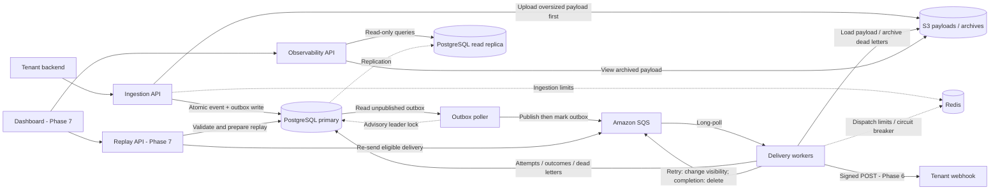

# Waybill - Project Guide

A multi-tenant webhook delivery platform, built to learn distributed systems. A waybill is the document that travels with a shipment and proves it arrived. This project applies that idea to HTTP events.

---

## 1. Problem Statement

Company A's backend needs to notify Company B's server when events happen ("payment.succeeded", "order.shipped"). Company B's endpoint may be slow, down, or flaky. The system must guarantee **every event eventually arrives**, **without losing events**, **without hammering dead endpoints**, and **without one noisy tenant starving others** - across thousands of tenants concurrently.

---

## 2. Tech Stack

| Layer | Choice | Why |
|---|---|---|
| Language/Runtime | TypeScript on Bun | Runs TS directly (no build step, even in Docker), fast installs/cold starts |
| API Framework | Express | Simple, well-documented, easy to reason about layer by layer |
| Database | PostgreSQL | Source of truth - tenants, events, deliveries, outbox |
| ORM | Prisma | Type-safe, migrations built in |
| Queue | **Amazon SQS** | Real managed queue - long polling, visibility timeouts, at-least-once delivery. Free tier covers this project many times over |
| Large payload / archive storage | **Amazon S3** | Claim-check pattern: SQS caps messages at 256KB, so payloads over that go to S3 and the queue carries a pointer. Also doubles as a permanent audit archive of delivered/failed payloads |
| Cache / rate limit / circuit breaker state | **Redis** | Per-tenant token buckets, per-destination circuit breaker state, hot tenant config. Not the queue anymore - SQS is |
| Containerization | Docker + docker-compose | Postgres + Redis run locally in containers; SQS/S3 are real AWS, hit directly even from your laptop |
| Logging | **Pino** | Structured JSON logs, correlation IDs threaded through API → queue → worker |
| Deployment | Railway or Render → AWS later if desired | Get something live early |

Local development needs an AWS account for SQS and S3. Start with the core delivery flow. Kafka and other infrastructure experiments can wait until the later phases.

### What this project does and doesn't teach

The main topics are:

- Message queues, caching, rate limiting, eventual consistency through the outbox, and observability through logs and later metrics.
- Leader election with Postgres advisory locks in Phase 2, a read replica in Phase 7, and sharding in Phase 8 if load tests show a need for it.
- Service discovery and distributed transactions/SAGAs are out of scope. Waybill does not have a service mesh or coordinate business transactions across services.

---

## 3. High-Level Architecture

The [architecture document](./waybill-architecture.md) defines the Phase 0-8 target, component boundaries, repository layout, and implementation status. It includes HMAC signing, observability, replay, and read-replica routing. The PDF is an earlier Phases 0-5 snapshot.



HMAC signing, the dashboard, replay, and the read replica are planned. Automatic retries use `ChangeMessageVisibility` on the existing SQS message. Manual replay is a separate Phase 7 operation. On retry exhaustion, the worker archives the payload and persists the dead-letter state before calling `DeleteMessage`. Delivery attempts are at least once; receivers must handle duplicates.

**Tenant fairness:** workers enforce per-tenant Redis token buckets over a shared SQS queue. Rate-limited messages are deferred through visibility changes without blocking dispatch for other tenants. The Phase 5 load test must validate delivery latency under uneven tenant traffic.

---

## 4. Repo structure

```
waybill/
├── docker-compose.yml
├── .env.example
├── packages/
│   ├── api/
│   │   └── src/
│   │       ├── routes/
│   │       ├── controllers/
│   │       ├── services/
│   │       ├── repositories/
│   │       └── middleware/
│   ├── worker/
│   │   └── src/
│   │       ├── jobs/
│   │       └── delivery/
│   ├── shared/
│   │   └── prisma/schema.prisma
│   └── dashboard/
└── docs/
```

---

## 5. Working habits

Work one phase at a time. Propose a file plan before writing code. Keep the layered structure (routes → controllers → services → repositories). Handle every async/AWS call explicitly. Explain *why* a pattern is used in comments, not just what the code does. Runtime is Bun (no build step). TypeScript strict mode.

- After each phase, write your own `PHASE_N_NOTES.md` - what was built and why. This becomes your own system design writeup later.
- Commit after every checkpoint, not after every file.

---

## 6. Phases & Checkpoints

### Phase 0 - Scaffolding - complete

- [x] Monorepo, Docker Compose (Postgres + Redis), Prisma schema + first migration
- [x] Empty API returns 200 on `GET /health`
- [x] AWS credentials in `.env`; `bun run check:aws` reaches the project SQS queue and S3 bucket
- [x] Notes: `docs/PHASE_0_NOTES.md`

### Phase 1 - Ingestion API + Outbox - complete

- [x] Layered `POST /events` writes Event + Outbox in one DB transaction
- [x] Small payload stored inline (`storedIn: "postgres"`)
- [x] Payload > 256KB stored via S3 claim-check (`payload` null, `payloadS3Key` set)
- [x] Notes: `docs/PHASE_1_NOTES.md`

### Phase 2 - Outbox Poller + Basic Delivery Worker - complete

- [x] Test receiver on `:4000`
- [x] Outbox poller publishes unpublished rows to SQS
- [x] Worker long-polls SQS and POSTs to the receiver
- [x] Two pollers: `pg_try_advisory_lock` so each row publishes once
- [x] Notes: `docs/PHASE_2_NOTES.md`

A poller reads unpublished outbox rows, sends them to SQS (`SendMessage`), marks them published. The worker long-polls SQS, POSTs to a test receiver, marks delivery succeeded or failed, and deletes the SQS message only on success. No retries yet.

Leader election: `pg_try_advisory_lock` on a single Postgres connection. Only the lock holder polls. The standby takes over if the leader disconnects.

Done when: a POSTed event becomes a real HTTP call on the receiver, the SQS message is deleted only after success, and two pollers produce one publish per row.

### Phase 3 - Retries with Backoff + Dead Letter - complete

- [x] `dead_letters` table (payload archived at `payload_s3_key`)
- [x] Exponential backoff + jitter before retrying a failed delivery
- [x] After N attempts, delete from SQS and write a dead-letter row
- [x] Notes: `docs/PHASE_3_NOTES.md`

On failure, do not delete the SQS message. Let visibility expire so it is redelivered. Track attempts on `deliveries` and wait with exponential backoff plus jitter. After `MAX_DELIVERY_ATTEMPTS`, delete from SQS, archive the payload to S3 if needed, and insert `dead_letters`.

Done when: attempt timestamps grow exponentially, and exhausted events land in `dead_letters` with the payload retrievable from S3.

### Phase 4 - Circuit Breaker
- [x] Redis-backed circuit breaker keyed by destination URL: closed → open (after N consecutive failures) → half-open (test one request) → closed/open again. Checked by the worker *before* every delivery attempt, independent of SQS.
- [x] Killing the test receiver causes the worker to stop attempting delivery for a cooldown window instead of retrying constantly, then automatically probes again.
- [x] Notes: `docs/PHASE_4_NOTES.md`

### Phase 5 - Rate Limiting & Multi-Tenant Fairness
- [x] Token bucket per tenant in Redis, applied at ingestion (`POST /events`) and at dispatch (worker skips over-limit tenants' messages instead of blocking).
- [x] Independent ingestion and delivery budgets per tenant.
- [x] Repeatable 10k-request runner with baseline and per-tenant delivery measurements.
- [x] Verify the rate-limited 10k-request burst with concurrent quiet-tenant traffic.
- [ ] Validate dispatch fairness under a sustained backlog of accepted events.
- Measured quiet-tenant p95 improved from 226 seconds to 25.7 seconds against the unchanged 30-second threshold. All accepted events arrived. The passing run admitted 246 of the busy tenant's 10,000 requests; the rest received HTTP 429.
- Notes: [Phase 5](./PHASE_5_NOTES.md) (in progress).
- **Done when:** simulate one tenant firing 10k events while another tenant's events still get delivered promptly, even though both share the same SQS queue.

### Phase 6 - Security: HMAC Signing & Verification
- Sign each webhook payload with a per-tenant secret (HMAC-SHA256), send as a header. Build a tiny example receiver-side verification snippet.
- **Done when:** a tampered payload fails verification on the receiver side.

### Phase 7 - Dashboard/API for Observability
- Delivery logs per tenant, success rate, DLQ browsing (pulling archived payloads from S3), manual replay (re-send to SQS).
- **Replication:** use a managed Postgres read replica for dashboard queries. Ingestion and worker status updates stay on the primary. This keeps dashboard read traffic off the write database.
- **Done when:** you can see a failed delivery in the dashboard, view its archived payload, manually replay it successfully, and confirm (e.g. via a deliberate replication lag test) that dashboard reads are hitting the replica, not the primary.

### Phase 8 - Load Testing & Hardening
- Use `k6` or `autocannon` to simulate bursts. Find where it breaks (DB connection pool? SQS throughput? Redis latency? worker concurrency?), fix it, document what you learned.
- **Sharding:** only if load tests show `deliveries` is the bottleneck, split it by `tenantId` hash across two Postgres schemas or databases. Route reads and writes through the repository layer. Document the cost of shard routing and cross-tenant queries, such as finding the top 10 tenants by volume.
- **Done when:** you have a before/after write-up of a real bottleneck you found and fixed, and (if you did the sharding exercise) a note on what got harder once data was split.

### Phase 9 - Stretch Goals (optional)
- Move to SQS FIFO with per-tenant `MessageGroupId` for stronger ordering guarantees.
- Add Prometheus + Grafana dashboards.
- Multi-region delivery workers.
- Explore Kafka as an alternative to SQS - learn partitioning and consumer groups for real.

---

## 7. Production Readiness Checklist

- **Config:** all secrets (including AWS keys) via env vars, never committed.
- **IAM:** scope the AWS credentials to only the specific SQS queue and S3 bucket this project uses - not full account access.
- **Migrations:** Prisma migrations checked into git, run automatically on deploy.
- **Health checks:** `/health` (liveness) and `/ready` (readiness - DB/Redis/SQS reachability) on both API and workers.
- **Graceful shutdown:** workers finish in-flight SQS messages before exiting on SIGTERM, rather than letting them time out.
- **Logging:** structured JSON logs (Pino), correlation/request IDs threaded through API → SQS message attributes → worker.
- **Error tracking:** Sentry (free tier) wired in early.
- **Backups:** Postgres automated backups even on a hobby-tier host.
- **Read replica connection string** kept separate from the primary's in config, so it's a one-line swap if the replica ever needs to be promoted or removed.
- **Advisory lock TTL/heartbeat:** make sure a crashed poller actually releases its leader lock (session-scoped locks release on disconnect) - test this by killing `-9` the leader process and confirming the standby takes over within a few seconds.
- **S3 lifecycle policy:** archived payloads should expire after a reasonable retention window, not grow forever.
- **Rate limit the ingestion API itself**, not just outbound delivery.

---

## 8. Deployment Plan

1. **Local:** docker-compose for Postgres + Redis; SQS/S3 are hit directly from your laptop using real AWS credentials from day one - no local emulation needed.
2. **First deploy (Phase 1-2 done):** push API + worker to Railway or Render, managed Postgres + Redis add-ons, same AWS SQS/S3 as local.
3. **CI:** GitHub Actions - run tests + Prisma migration check on every PR, deploy on merge to main.
4. **Later (optional):** move to full AWS (ECS/EC2 + RDS + ElastiCache) once you specifically want to learn cloud infra deployment.
