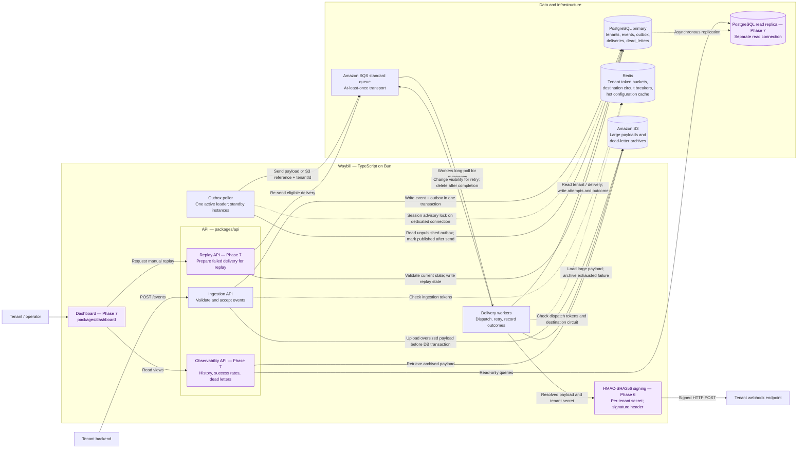
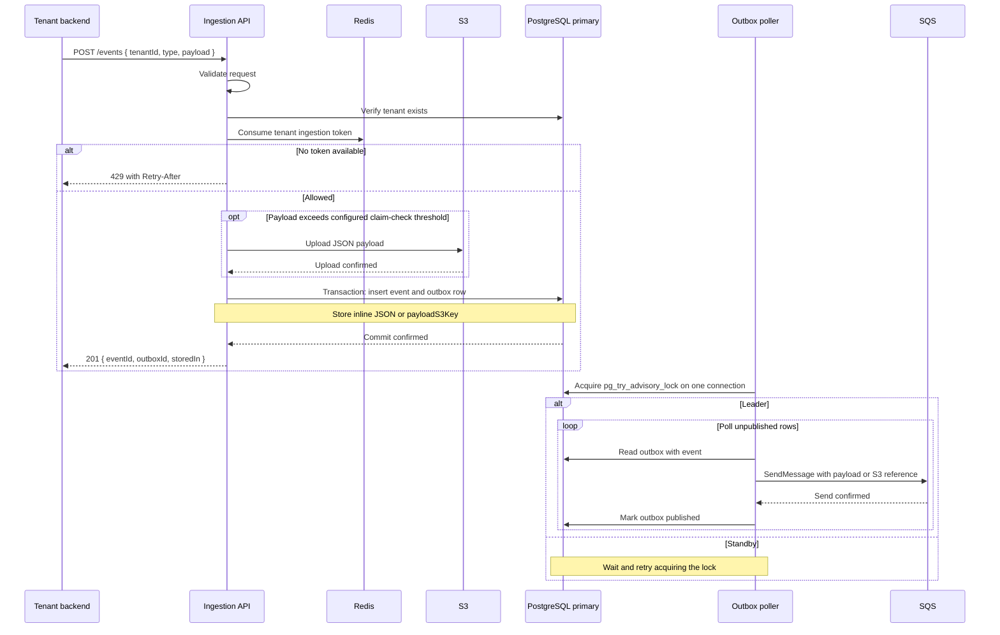
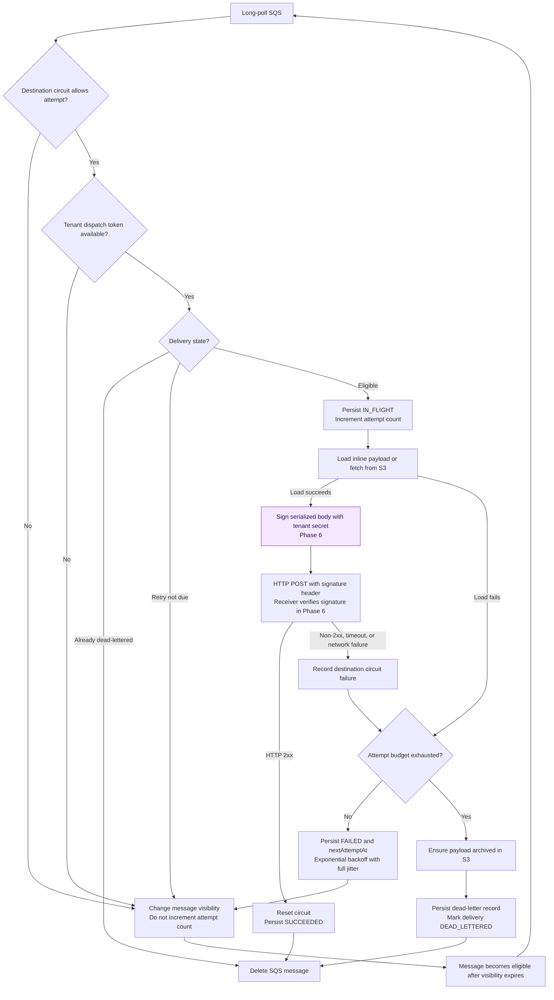
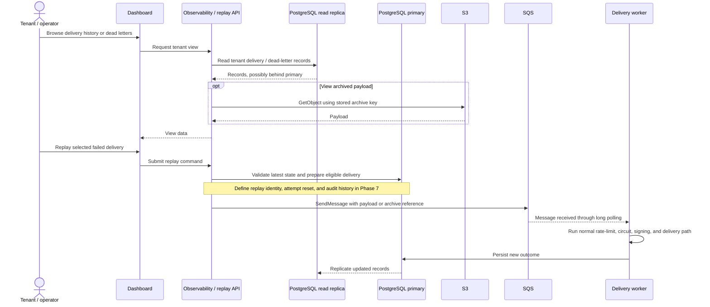

# Waybill — target architecture

This is the intended final design from [the project guide](./project-guide.md), covering Phases 0–8. It is a design map, not a claim that every component is implemented. Mermaid keeps diagrams reviewable alongside code and renders in GitHub Markdown.

The earlier [Excalidraw board](./waybill-architecture.excalidraw) and [PDF](./waybill-architecture.pdf) are Phases 0–5 snapshots; they do not represent the complete target below.

## 1. System overview

Read the delivery path from left to right. Purple nodes are planned Phase 6–7 capabilities. Solid arrows show requests or data operations; dashed arrows show control checks or replication. Labels specify whether a store operation is a read or a write.



The signer and Phase 7 API boxes are logical responsibilities within the worker and API, not additional services. The outbox poller is a separate runnable process in `packages/worker`; starting the delivery worker does not start it.

Dashboard database reads use the replica. Replay is a command: its authoritative state checks and writes use the primary. Replica lag means the dashboard may briefly display an older delivery status. Hot configuration caching is a target from the guide, not yet implemented.

## 2. Accept and publish an event



- The ingestion endpoint does not publish to SQS. The committed outbox records the obligation to publish.
- The repository uses a 256 KiB claim-check threshold. Treat this as project configuration, rather than a statement about the current AWS service limit. Queue sizing must include the complete message envelope and attributes.
- The current queue body is `{ eventId, tenantId, type, payload, payloadS3Key }`, with `tenantId` also a message attribute. The S3 bucket comes from configuration. Correlation-ID propagation is a production-readiness target.
- S3 upload happens before the transaction. A failed transaction can leave an orphan object, but cannot commit an event without its outbox row.
- A crash after `SendMessage` but before marking the row published can produce a duplicate. Advisory locks coordinate pollers; they do not make PostgreSQL and SQS one atomic transaction.

## 3. Deliver, retry, or dead-letter

This is the intended delivery lifecycle, including Phase 6 signing. It omits malformed-message handling to keep the main path readable; today's worker logs and deletes malformed queue messages.



Retries retain the existing SQS message and change its visibility; they do not publish a replacement message. If archiving or persistence fails, the worker must leave the message undeleted so it can be processed again.

The delivery guarantee is **at least once**, with bounded automatic retries and durable dead letters. A permanently unavailable endpoint cannot be guaranteed to receive an event. Receivers must tolerate duplicate `eventId` values. The current code also lacks an explicit skip for already-successful deliveries.

## 4. Observe and manually replay — Phase 7 target



The guide specifies manual re-send to SQS but does not yet define replay persistence or duplicate-command handling. Phase 7 must make the delivery eligible again: re-sending an unchanged `DEAD_LETTERED` delivery would be discarded by today's worker. It must also address a crash between the primary write and queue publication, for example by extending the outbox design. This is the logical flow, not a completed atomic replay protocol.

## 5. Target repository layout

Existing paths are shown without annotations. Entries marked **planned** describe responsibilities from the guide; exact files will be chosen in the relevant phase.

```text
waybill/
├── packages/
│   ├── api/
│   │   └── src/
│   │       ├── index.ts                 Express application and health endpoint
│   │       ├── routes/                  Ingestion; observability/replay planned
│   │       ├── controllers/             HTTP input/output and error mapping
│   │       ├── services/                Business rules and transactions
│   │       ├── repositories/            DB access; replica reads planned
│   │       ├── middleware/              Placeholder for cross-cutting HTTP logic
│   │       └── rate-limit.ts            Ingestion token enforcement
│   ├── worker/
│   │   └── src/
│   │       ├── index.ts                 SQS receive and delivery orchestration
│   │       ├── outbox-poller.ts         Separate publisher process and leader lock
│   │       ├── delivery/                HTTP, backoff, circuit breaker, rate limits
│   │       │                           HMAC signing planned in Phase 6
│   │       ├── repositories/            Outbox, deliveries, dead letters
│   │       └── jobs/                    Existing placeholder
│   ├── shared/
│   │   ├── src/                        Prisma, AWS clients, queue and rate-limit types
│   │   │                               Separate replica client planned in Phase 7
│   │   ├── prisma/
│   │   │   ├── schema.prisma
│   │   │   └── migrations/
│   │   └── scripts/                    AWS check, seed, event clients, receiver
│   └── dashboard/                      Planned in Phase 7; framework not selected
├── docs/                               Guide, phase notes, architecture
├── docker-compose.yml                  Local Postgres/Redis; API/worker definitions
├── .env.example
└── package.json                        Bun workspace and development commands
```

The dashboard calls the API; it never receives database credentials. API layering remains `routes → controllers → services → repositories`. Shared code provides common clients and types rather than HTTP business logic.

## 6. Phase boundaries and operational requirements

| Scope | Target | Current repository |
|---|---|---|
| Phases 0–3 | Ingestion, outbox, leader election, delivery, retries, dead letters | Implemented with phase notes |
| Phase 4 | Per-destination circuit breaker with one recovery probe | Implemented; atomic cross-worker probe coordination still needs hardening |
| Phase 5 | Tenant limits at ingestion and dispatch; demonstrated noisy-tenant fairness | Limiters implemented; both currently share one Redis key per tenant; fairness checkpoint not documented |
| Phase 6 | HMAC signing and receiver verification | Planned; tenant secret field already exists |
| Phase 7 | Dashboard, observability API, payload viewing, replay, read replica | Planned |
| Phase 8 | Measure bottlenecks and harden the system | Planned; shard deliveries by tenant only if measurements justify it |
| Phase 9 | FIFO ordering, Prometheus/Grafana, multiple regions, Kafka exploration | Optional extensions, outside the baseline diagram |

Today's worker sends every event to one configured `RECEIVER_URL`. The final product needs tenant destination resolution; the guide does not yet specify its configuration API or schema. The endpoint box represents that intended capability, not an existing endpoint-management feature.

The operational target also includes external-call timeouts, graceful shutdown, liveness/readiness checks, Pino logs with correlation IDs across API/SQS/worker, Sentry error tracking, scoped IAM, environment-managed secrets, migration checks in CI, database backups, and S3 retention. These are cross-cutting requirements from the guide, not additional delivery services or claims of current completeness. Successful-delivery payload archiving is mentioned in the guide's stack overview but has no defined phase checkpoint; the diagram shows the explicit claim-check and dead-letter archive paths.

Local development uses Docker for PostgreSQL and Redis and real AWS for SQS/S3. The initial hosted target is Railway or Render with managed PostgreSQL/Redis; moving compute and databases to AWS is optional. Any measured sharding change needs a revised diagram that also accounts for dashboard reads and replica routing.
