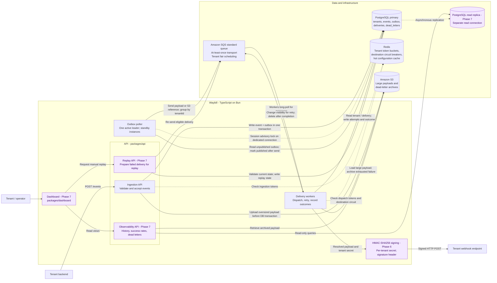
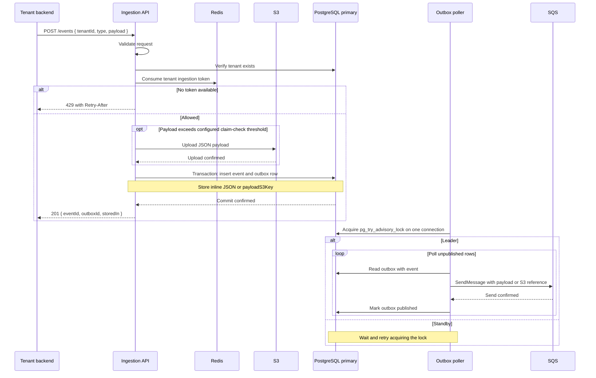
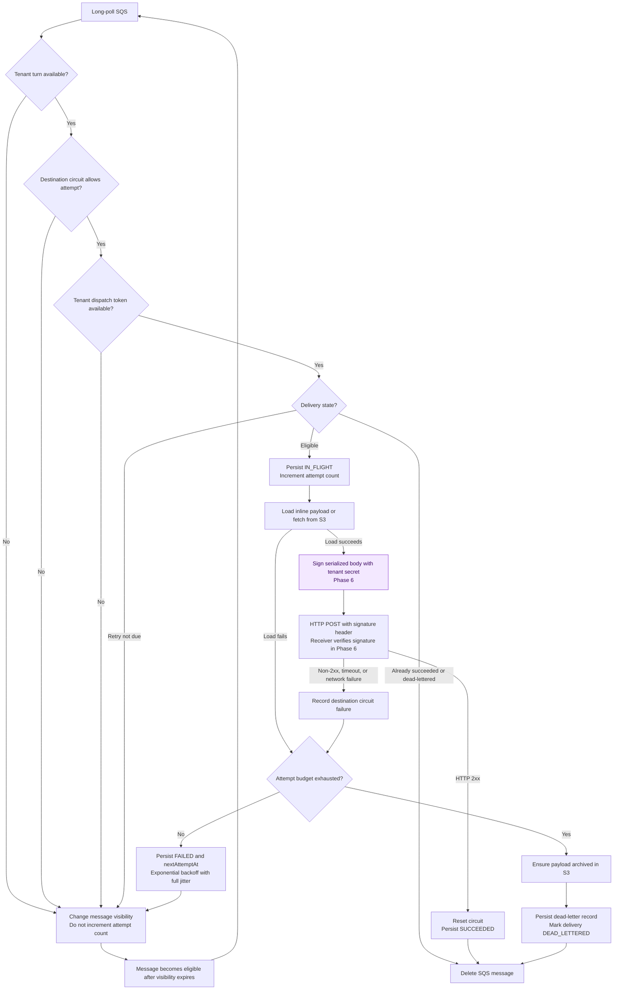
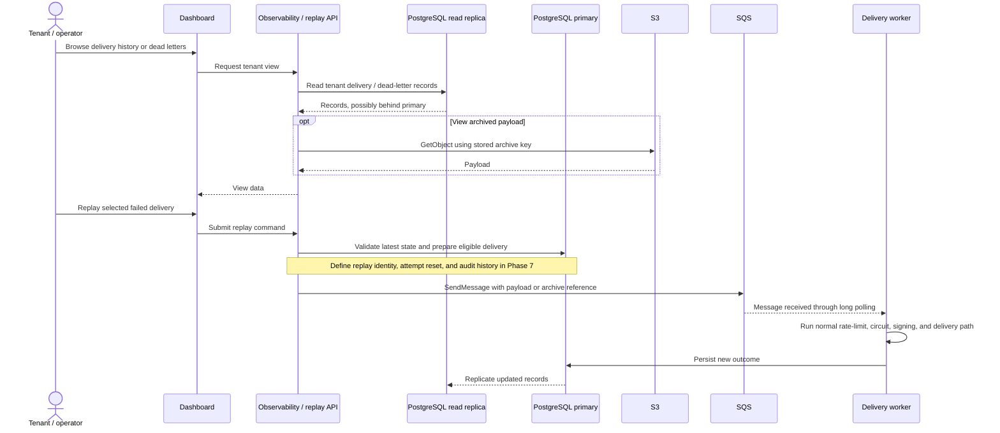

# Waybill - target architecture

Target architecture for Phases 0-8 of [the project guide](./project-guide.md). Implementation status is tracked in Section 6.

The [PDF](./waybill-architecture.pdf) is an earlier Phases 0-5 snapshot. The Mermaid diagrams below describe the current target.

## 1. System overview

The delivery path runs left to right. Purple nodes indicate planned Phase 6-7 components. Solid edges represent requests and data operations; dashed edges represent control checks or replication.



HMAC signing is part of the delivery worker. Observability and replay are API modules. The outbox poller and delivery worker are separate processes within `packages/worker`.

Dashboard queries use a dedicated read-replica connection. Replay validates authoritative state and persists changes on the primary. Dashboard views are eventually consistent due to replication lag. Tenant configuration caching remains planned.

## 2. Ingestion and outbox publication



- The API commits the event and outbox entry atomically. The poller handles SQS publication.
- The configured claim-check threshold is 256 KiB. This is a project setting, not the current AWS service limit. Size checks also need to account for the message envelope and attributes.
- The current queue body is `{ eventId, tenantId, type, payload, payloadS3Key }`, with `tenantId` also a message attribute and `MessageGroupId` set to the same tenant ID. The S3 bucket comes from configuration. Correlation-ID propagation is a production-readiness target.
- S3 upload happens before the transaction. A failed transaction can leave an orphan object, but cannot commit an event without its outbox row.
- A crash after `SendMessage` but before marking the row published can produce a duplicate. Advisory locks coordinate pollers; they do not make PostgreSQL and SQS one atomic transaction.

## 3. Delivery lifecycle

This flow includes the pre-attempt tenant selection budget and Phase 6 HMAC signing. Malformed-message handling is omitted; the current worker logs and deletes invalid queue messages.



Retries retain the existing SQS message and change its visibility; they do not publish a replacement message. If archiving or persistence fails, the worker must leave the message undeleted so it can be processed again.

The delivery guarantee is **at least once**, with bounded automatic retries and durable dead letters. A permanently unavailable endpoint cannot be guaranteed to receive an event. Receivers must tolerate duplicate `eventId` values. A redelivery with an existing `SUCCEEDED` record is acknowledged without repeating the webhook, but a crash between HTTP success and persistence can still cause duplicates.

The publisher selects pending rows in tenant rounds and sends up to ten concurrently. It sets `MessageGroupId = tenantId` to enable SQS standard-queue fair scheduling; a custom message attribute alone does not enable it. Its starting tenant rotates between batches. Productive batches continue immediately; idle polls and failures retain a delay. The worker uses up to ten concurrent long polls and buffers at most one hundred messages. Webhook deliveries remain sequential. Each receive cycle selects up to ten messages per tenant and defers excess messages in visibility batches. Reservations are renewed for waiting/active work and released before retry delays or deletion. Completed SQS deletions overlap within the ten-message response being processed.

## 4. Observability and replay (Phase 7)



Replay semantics are pending Phase 7. Replayed messages must retain `MessageGroupId = tenantId` for fair scheduling. The worker discards messages associated with a `DEAD_LETTERED` delivery, so replay must transition the delivery to an eligible state or create a new delivery record. The implementation must define attempt accounting, audit history, command idempotency, and recovery from a crash between the database write and SQS publication. Extending the transactional outbox is one option.

## 5. Target repository layout

Annotations distinguish existing modules from planned additions. File-level design is deferred to the relevant phase.

```text
waybill/
├── packages/
│   ├── api/
│   │   └── src/
│   │       ├── index.ts                 Express application and health endpoint
│   │       ├── routes/                  Ingestion; observability/replay planned
│   │       ├── controllers/             HTTP input/output and error mapping
│   │       ├── services/                Business rules and transactions
│   │       ├── repositories/            DB access; replica reads planned
│   │       ├── middleware/              Placeholder for cross-cutting HTTP logic
│   │       └── rate-limit.ts            Ingestion token enforcement
│   ├── worker/
│   │   └── src/
│   │       ├── index.ts                 SQS receive and delivery orchestration
│   │       ├── outbox-poller.ts         Separate publisher process and leader lock
│   │       ├── delivery/                HTTP, backoff, circuit breaker, rate limits
│   │       │                           HMAC signing planned in Phase 6
│   │       ├── repositories/            Outbox, deliveries, dead letters
│   │       └── jobs/                    Existing placeholder
│   ├── shared/
│   │   ├── src/                        Prisma, AWS clients, queue and rate-limit types
│   │   │                               Separate replica client planned in Phase 7
│   │   ├── prisma/
│   │   │   ├── schema.prisma
│   │   │   └── migrations/
│   │   └── scripts/                    AWS check, seed, event clients, receiver
│   └── dashboard/                      Planned in Phase 7; framework not selected
├── docs/                               Guide, phase notes, architecture
├── docker-compose.yml                  Local Postgres/Redis; API/worker definitions
├── .env.example
└── package.json                        Bun workspace and development commands
```

The dashboard calls the API; it never receives database credentials. API layering remains `routes → controllers → services → repositories`. Shared code provides common clients and types rather than HTTP business logic.

## 6. Phase boundaries and operational requirements

| Scope | Target | Current repository |
|---|---|---|
| Phases 0-3 | Ingestion, outbox, leader election, delivery, retries, dead letters | Implemented with phase notes |
| Phase 4 | Per-destination circuit breaker with one recovery probe | Implemented; atomic cross-worker probe coordination still needs hardening |
| Phase 5 | Tenant limits at ingestion and dispatch; demonstrated noisy-tenant fairness | Independent buckets, tenant rotation in publication, and overlapping SQS acknowledgements implemented; rate-limited 10k-request check passed at 25.7-second quiet p95; accepted-backlog p95 passed at 25.2 seconds with explicit tenant turns and batched deferral; quiet maximum 63.5 seconds and busy-throughput cost remain hardening work |
| Phase 6 | HMAC signing and receiver verification | Planned; tenant secret field already exists |
| Phase 7 | Dashboard, observability API, payload viewing, replay, read replica | Planned |
| Phase 8 | Measure bottlenecks and harden the system | Planned; shard deliveries by tenant only if measurements justify it |
| Phase 9 | FIFO ordering, Prometheus/Grafana, multiple regions, Kafka exploration | Optional extensions, outside the baseline diagram |

Delivery currently uses a single configured `RECEIVER_URL`. Per-tenant destination resolution requires a configuration API and schema changes that are not yet specified.

Production requirements include external-call deadlines, graceful shutdown, liveness/readiness probes, structured Pino logs with correlation IDs, Sentry, scoped IAM, environment-based secrets, CI migration checks, database backups, and S3 lifecycle policies. Implementation status must be verified against the guide's readiness checklist. Successful-delivery archiving has no assigned phase; the diagrams cover claim-check storage and dead-letter archives.

Local infrastructure consists of containerized PostgreSQL and Redis with AWS-hosted SQS and S3. Initial deployment targets Railway or Render with managed PostgreSQL and Redis. A full AWS deployment is optional. Any sharding introduced after load testing must account for repository routing, cross-tenant queries, and replica reads.
